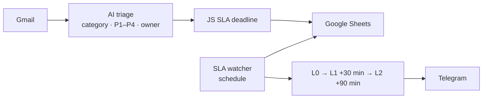

# HouseBox — AI Customer Support & SLA Automation

> AI triage of support emails (6 categories, P1–P4) with SLA tracking and 3-level escalation in Telegram.

 

## Problem

- Support emails were triaged by hand.
- Overdue tickets were not escalated in time.

## Solution

Built in **n8n**:

1. AI classifies Gmail emails: 6 categories, P1–P4 priority, sentiment, owner
2. JavaScript calculates SLA deadlines and overdue time, filters spam
3. SLA watcher workflow with 3-level escalation: L0, L1 after 30 min, L2 after 90 min
4. Telegram alerts to the right person at each level

## Architecture

## Tech stack

- n8n
- Gmail
- LLM
- Google Sheets
- JavaScript
- Telegram Bot API

## Results

- Every email gets a category, priority and owner automatically
- Overdue tickets are escalated automatically

## Workflow files

The production workflow JSON is not published publicly. I'm happy to walk you through it on a call or adapt it to your stack.

## Case study & demo

Full case study with screenshots and a demo video: **[Notion portfolio](https://tree-plantain-8cf.notion.site)**

## Author

**Kyrylo Kirillov** — AI Automation Engineer (n8n, Make, LLM agents)  
[Upwork](https://www.upwork.com/freelancers/~019bcb1ca9cd59b3ad) · [LinkedIn](https://www.linkedin.com/in/kirillov-kirill) · [Portfolio](https://tree-plantain-8cf.notion.site) · Telegram [@Veter218](https://t.me/Veter218)
